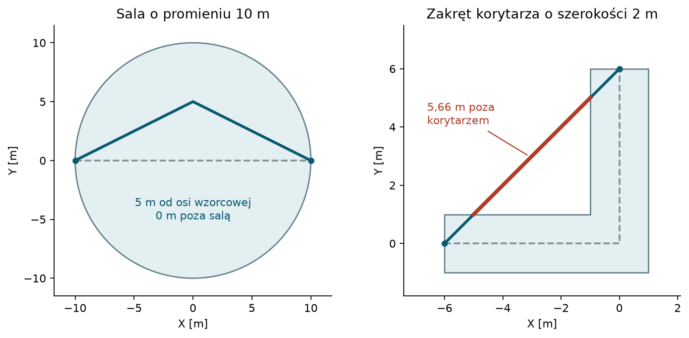

# Jak porównywać szkielety różnych jaskiń

Każdy algorytm oceniamy według tych samych dwóch pytań. **Które rzeczywiste przejścia odtworzył? Jaka część jego odcinków wychodzi poza znane wnętrze?** Pierwsza odpowiedź wykrywa np. utratę odnogi. Druga ujawnia skrót przez skałę przy poprawnie połączonych stacjach. Obie wartości zachowujemy w raporcie. Na tym etapie nie ustalamy wyniku progowego.

## 1. Połączenia między korytarzami

W modelu syntetycznym wzorzec zawiera końce, wyloty korytarzy do sal, połączenia i osobne drogi wokół przegród. Wzorzec określa się po utworzeniu bryły. Dwa tunele wygenerowane obok siebie mogą zlać się w jedną salę, jeśli ich przekroje są szerokie. W realnym skanie do oceny trafiają fragmenty z niezależnie opisanymi przejściami. Wylot można oznaczyć przekrojem, przez który powinien przechodzić ciąg. Na skrzyżowaniu wielopoziomowym położenie i rozdzielenie przejść sprawdzamy w 3D.

Przed porównaniem łączymy kolejne odcinki jednego korytarza pomiędzy istotnymi miejscami. W obrębie oznaczonej otwartej sali uznajemy różne przebiegi łączące te same wyloty. Gwiazda z czterema wylotami oraz dwa rozwidlenia łączące te same cztery wyloty są równoważne. Odcinki w sali wciąż podlegają pełnej kontroli względem ścian i wewnętrznych przeszkód. Obejścia rozdzielone filarem i odrębne korytarze zachowujemy jako osobne drogi, również między tą samą parą węzłów.

Odpowiadające sobie przejścia przypisujemy jeden do jednego na podstawie położenia ich wylotów i przebiegu przez właściwe korytarze. Liczymy przejścia odtworzone (`TP`), nadmiarowe (`FP`) i pominięte (`FN`). Z nich wynikają **precyzja** `TP/(TP+FP)`, **czułość** `TP/(TP+FN)` i **F1** `2TP/(2TP+FP+FN)`. Pusty mianownik oznaczamy jako brak podstaw do wyznaczenia danej miary. Raport wskazuje identyfikatory brakujących odnóg, fałszywych połączeń i pętli. Sama zgodność liczby cykli dopuszcza sytuację, w której algorytm zgubił pętlę w jednym korytarzu i dodał ją w innym. [Definicja F1](https://scikit-learn.org/stable/modules/generated/sklearn.metrics.f1_score.html)

W Wielkiej Śnieżnej z jednej stacji `LTn0` w Sali nad Płytowcem zapisano dziesięć celowych długości 2,70–9,10 m, a osobny odcinek prowadzi do tej stacji. Potraktowanie stopnia 11 jako wzorca liczby korytarzy premiowałoby odtworzenie układu celowych. W skompilowanym prefiksie `WielkaSniezna` brak rekordów przekrojów `XSECT`. Wyloty tej sali wymagają opisu z planu, przekrojów lub niezależnej interpretacji skanu. [Pomiar Sali nad Płytowcem w JKTZ](https://github.com/dlubom/Jaskiniowy-Kataster-Tatr-Zachodnich/blob/b27c5bff31487ff48287e65de41c1a988224e732/Poligony/D_Malej_Laki/Przechod-Kotliny/Syst_W_Snieznej/sniezna/LITWOR.SRV#L253-L265)

## 2. Położenie całych odcinków względem ścian

Każdy fragment wyeksportowanej łamanej oznaczamy jako **wewnątrz**, **poza korytarzem** lub **brak wystarczającej obserwacji**. W syntetyku odcinek przecinamy z bryłą użytą do wygenerowania ścian. Dla rzeczywistego skanu stosujemy niezależnie ocenione przekroje lub powierzchnie tam, gdzie da się rozstrzygnąć stronę ściany. Brak odbić może oznaczać wolną przestrzeń albo brak widoczności. Sam odstęp od najbliższego odbicia nie rozstrzyga, po której stronie ściany leży punkt. Woksele wyznaczone przez oceniany algorytm nie stanowią niezależnego wzorca.

Raport podaje długość **poza** i **nieocenioną** w jednostkach źródła oraz jako procent całego ciągu. Pokazuje także najdłuższy ciągły fragment poza korytarzem, jego położenie i maksymalną głębokość wejścia poza wnętrze tam, gdzie model na to pozwala. Do prezentacji dzielimy wynik na odcinki, lecz długość jednego przekroczenia liczymy przez kolejne stacje, aż ciąg wróci do środka. Pojedyncze przejście przez ścianę pozostaje widoczne nawet w wielokilometrowej sieci. Dla bryły wokselowej zapisujemy rozdzielczość i niepewność granicy. Przy próbkowaniu odcinka zapisujemy krok i wynik jako oszacowanie.

### Dwie kontrole analityczne

W obu próbach trasa leży w płaszczyźnie `z = 0`, a współrzędne podano w metrach. Sala jest kulą o środku `(0, 0, 0)` i promieniu 10 m. Do powtórzenia zakrętu w 3D przyjmujemy sumę dwóch domkniętych prostopadłościanów. Ich przedziały w kolejności X, Y, Z wynoszą `[−6, 1] × [−1, 1] × [−1, 1]` i `[−1, 1] × [−1, 6] × [−1, 1]`. W tych kontrolach wzorzec obejmuje całą badaną trasę.

| Przypadek ze znanym wnętrzem | Zgodne pary wylotów | Długość ciągu | Długość poza | Najgłębsze wyjście |
|---|---:|---:|---:|---:|
| Dwa wyloty kulistej sali o promieniu 10 m, trasa odchylona od osi o 5 m | 1/1 | 22,36 m | 0 m | 0 m |
| Dwa końce korytarza o szerokości 2 m, połączone po przekątnej zakrętu | 1/1 | 8,49 m | 5,66 m (66,7%) | 2,00 m |

Obliczenia dotyczą dwóch zadanych tras kontrolnych. W pierwszej poprowadzono łamaną przez punkty `(−10, 0), (0, 5), (10, 0)` na wysokości środka sali. W drugiej przekątna biegnie od `(−6, 0)` do `(0, 6)`, wychodzi przez ścianę w `(−5, 1)` i wraca w `(−1, 5)`. Długość zewnętrznego fragmentu wynosi dokładnie `4√2 m`. Odległość od historycznej osi można nadal pokazywać pomocniczo, np. w przewężeniu. Nie decyduje ona o jakości przebiegu w sali.

## Jeden raport na jaskinię i wersję algorytmu

| Co zapisujemy | Jednostka porównania |
|---|---|
| TP, FP, FN i F1 dla przejść | Oznaczona sieć po uwzględnieniu otwartych sal, z identyfikatorami błędów i osobną listą pominiętych lub dodanych obejść |
| Długość poza wnętrzem oraz nieoceniona, obie również w % | Cała długość zwróconej sieci. Przy pustej sieci podajemy brak wyniku oraz liczbę pominiętych przejść |
| Najdłuższy skrót poza korytarzem i jego maksymalna głębokość | Metry przy potwierdzonej skali, w pozostałych przypadkach jednostki modelu. Pokazujemy lokalizację do oględzin |
| Zasięg oceny | Liczba porównanych i nieocenionych przejść, pokrycie wzorca wzdłuż każdego ramienia, liczba całych przypadków bez wyniku |
| Początek | Wybrany rodzaj, źródło i błąd położenia wobec wzorca tego samego rodzaju, osobno dla trybu automatycznego i ręcznego |
| LRUD | Dla każdego z czterech wymiarów mediana i 95. percentyl błędu oraz odsetek stacji z wynikiem i przypadki wartości podanej bez pokrycia skanem |
| Survex | Wynik kompilacji oraz zgodność po odczycie stacji, odcinków i przekrojów z `.3d` |

Dla LRUD w syntetyku wymiary wzorcowe wyznaczamy od rzeczywistego położenia ocenianej stacji w kierunkach jej przekroju. Przesunięcie poprawnego ciągu w stronę jednej ściany sali zmienia oczekiwane L i R. Przy braku ustalonego pionu lub kierunku trzeba osobno wskazać, które wymiary da się zinterpretować.

Gdy znamy tylko fragment skanu, F1 dotyczy wyłącznie oznaczonego obszaru. W podsumowaniu metod każda jaskinia ma własny wiersz. Można podać średnią wartości z jaskiń, liczbę ocenionych przypadków oraz najgorszy potwierdzony skrót. Dzięki temu duża jaskinia z tysiącami odcinków nie przesądza wyniku całego porównania.

## Train, validation, test

1. **Jednostką podziału jest jaskinia lub wspólny system.** Ta sama źródłowa sieć `.3d`, jej fragmenty, obroty, szum, warianty ścian i powtórne skany pozostają w jednym zbiorze. W modelach czysto analitycznych grupujemy warianty tej samej geometrii bazowej. Przy niepewnej tożsamości dwóch skanów unikamy przypisania ich do przeciwstawnych zbiorów.
2. **Train** służy do uczenia lub projektowania algorytmu. **Validation** służy do doboru modelu, parametrów i porównania wariantów. **Test** obejmuje odrębne jaskinie i ocenia zamrożoną metodę. Przy małej liczbie jaskiń można na materiale rozwojowym kolejno odkładać całe obiekty do walidacji. Proporcje podziału ustalimy po zgromadzeniu niezależnych obiektów. [Walidacja z grupami](https://scikit-learn.org/stable/modules/cross_validation.html#group-k-fold)
3. **Stosujemy te same wejścia i ten sam oceniający program** dla metody geometrycznej, ML i deep learning. Oś źródłowa, bryła, opisy wylotów i etykiety nie trafiają na wejście ekstraktora podczas oceny. Tryb całkowicie automatyczny i tryb z punktem użytkownika raportujemy oddzielnie. Przy porównaniu rejestrujemy dostępność czasu, układu i skali.
4. **Wersjonujemy zestaw i metodę oceny.** Każdy wynik wskazuje wersję algorytmu, dane, podział, ustawienia i wersję wzorca. Przy zmianie metryki ponownie oceniamy zapisane wyniki metod na wspólnych danych. W tabeli rozróżniamy dane syntetyczne i rzeczywiste oraz przypadki z salami, studniami, pętlami, rozgałęzieniami i lukami obserwacji.
5. **Dzisiejsze wyniki są punktem odniesienia dla rozwoju.** Fragment Kalackiej, 12 znanych przypadków `--holdout` oraz oba oglądane LAZ były już analizowane. Niezależny test terenowy wymaga kolejnych skanów z ustaloną przynależnością i odpowiednim wzorcem. Nowy skan bez opisanych wylotów umożliwi kontrolę wybranych ścian i przekrojów, ale pełny F1 pozostanie nieoznaczony.

Na dziś mamy rzeczywisty wynik ekstraktora z Kalackiej oraz dwie obliczone kontrole interpretacji metryk. Implementacja pełnego oceniającego programu, oznaczenie wylotów i niezależny zestaw testowy to dalsza praca. [Próba na Kalackiej i 12 przypadków odniesienia](rozpoznanie.md)
