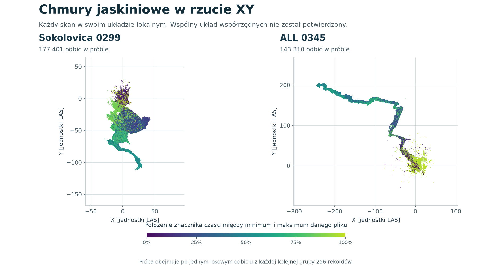
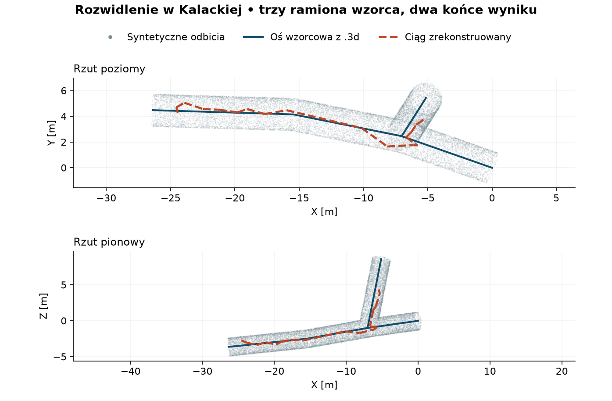

# Od odbić LiDAR do sieci korytarzy

Rozpoznanie z 22 listopada 2026 r. W rewizji `dc169f53112e688c3669d5db8b8aeb04ef3f014f` generator zapisał sieć, którą skompilował Survex. Na rozwidleniu zbudowanym z pomiarów Kalackiej zgubił jedno ramię mimo próbkowania całego obwodu korytarzy. Ten przypadek daje nam pierwszy punkt odniesienia do pomiaru postępu.

## Ustalenia

- Ciąg odwzorowuje sieć korytarzy. Ponowna wizyta operatora dostarcza dodatkowych obserwacji tego samego przejścia.
- Użytkownik może wybrać otwór, początek skanowania albo własny punkt. W trybie automatycznym biblioteka próbuje rozpoznać otwór. Jeżeli dane nie wystarczają, wykorzystuje wiarygodny początek skanowania, a ostatecznie wybiera techniczną stację. Wynik ma podawać podstawę wyboru.
- Gdy obserwacje nie wystarczają do stwierdzenia połączenia, ciąg zachowuje przerwę, a wynik wskazuje miejsce do kontroli.
- Docelowy plik Survex ma zawierać odcinki DX/DY/DZ oraz LRUD. Każdy z wymiarów przekroju może pozostać nieznany. Pozostałe wartości zachowujemy.
- Na etapie rozpoznania raportujemy liczby dla poszczególnych prób, bez progu zaliczenia.
- W otwartej sali równoważne przebiegi mogą mieć różne wewnętrzne rozwidlenia. Istotne są zachowane wyloty i rzeczywiste przejścia, w tym osobne drogi wokół filara. Każdy odcinek nadal podlega kontroli względem wnętrza.

Obecny ekstraktor wyprowadza sieć z XYZ. Czas analizuje osobne narzędzie diagnostyczne. Eksporter zapisuje odcinki kartezjańskie i lokalne dowiązania. Automatyczne rozpoznanie otworu, oznaczanie niepewnych połączeń oraz estymacja LRUD pozostają do opracowania. [Słownik](../../GLOSSARY.md) · [Ekstraktor](../../lidar_svx/topology.py) · [Diagnostyka akwizycji](../../lidar_svx/acquisition.py) · [Eksport Survex](../../lidar_svx/export.py)

## Dwie rzeczywiste chmury

Pliki leżą w `../sokolovica-cloud-survey/data/raw/`. Odczyt objął wszystkie rekordy. Oba pliki mają skompresowany format LAS 1.2, format punktu 1, pola XYZ, intensywność, `gps_time` i `point_source_id`. Krok zapisu XYZ wynosi 0,0001 jednostki, a offset 0. Nagłówki nie podają CRS ani jednostki fizycznej. W katalogu danych brak pliku z pozycjami skanera.

| Właściwość | `Sokolovica ALL_0299_ALIGN01zIMU.laz` | `ALL_0345_ALIGN00.laz` |
|---|---:|---:|
| Odbicia | 45 414 463 | 36 687 127 |
| Rozpiętość XYZ w jednostkach pliku | 144,84 × 217,05 × 106,85 | 379,36 × 342,81 × 167,07 |
| Identyfikatory źródła | jeden, 0 | 997 kolejnych bloków, 0–996 |
| Indeks rekordu o najniższym czasie, licząc od zera | 75 703 | 10 581 |
| Spadki czasu między kolejnymi rekordami | 22 722 850 | 18 353 724 |
| SHA-256 | `dcf8928213c0a67101b3335aabb93c4450fcf4ce7b1fb8617625a01ad0c4fc3d` | `4f3119cd1763eb397f9c9bf06d2983a09a8b85c3e9b2744c31f6e12442561700` |

Każdy rekord ma skończony, niezerowy czas, unikalny w swoim pliku. Wartości rzędu 10²⁷ przy deklaracji czasu GPS w nagłówku nie pozwalają wiarygodnie wyznaczyć sekund i daty akwizycji. Do badania kolejności można je sortować. W 0345 zakresy czasu kolejnych bloków są rozłączne i rosnące. W 0299 wszystkie rekordy mają jeden identyfikator, więc obecna diagnostyka wizyt oparta na blokach przekracza swój limit wielkości bloku. [Specyfikacja LAS 1.2, pole Global Encoding](https://www.asprs.org/a/society/committees/standards/asprs_las_format_v12.pdf)



Rycina pokazuje po jednym losowym odbiciu z każdej kolejnej grupy do 256 rekordów, z ziarnami 20261122 i 20261123. W obu skanach najwcześniejsze i najpóźniejsze odbicia występują w zbliżonym rejonie. Ten sygnał można zbadać jako wskazówkę początku skanowania. Określenie błędu pozycji wymaga niezależnej trajektorii albo wskazania terenowego. Tożsamość obiektu 0345 i jego powiązanie z 0299 pozostają niepotwierdzone.

## Wzorzec z wyrównanego pliku Survex

Źródłem osi jest `KATASTER.3d` z Jaskiniowego Katastru Tatr Zachodnich. Sprawdziliśmy również świeżą kompilację katalogu z rewizji `b27c5bff31487ff48287e65de41c1a988224e732` przy użyciu Survex 1.4.24. Poniższe polecenia uruchamia się z głównego katalogu `lidar-svx`. [Jaskiniowy Kataster Tatr Zachodnich](https://github.com/dlubom/Jaskiniowy-Kataster-Tatr-Zachodnich/tree/b27c5bff31487ff48287e65de41c1a988224e732)

```sh
wynik=$(mktemp -d)
cavern -o "$wynik/KATASTER.3d" ../Jaskiniowy-Kataster-Tatr-Zachodnich/KATASTER.wpj
dump3d -l -s Kalacka "$wynik/KATASTER.3d"
dump3d -l -s Pawlikowskiego:Mylna "$wynik/KATASTER.3d"
```

Odcinki pobieramy z rekordów `LEG`, zachowując ich pary końców. Do wzorca wybieramy podziemne odcinki sieci i pomijamy flagi `SURFACE`, `SPLAY` oraz `DUPLICATE`. Etykiety i flagi otworów odczytujemy z `NODE`. W Kalackiej `0` ma flagę `ENTRANCE`, a `1.0` ma flagę `UNDERGROUND` na tych samych współrzędnych. Łączenie kolejnych wierszy XYZ tworzyłoby odcinki między stacjami, których pomiar ze sobą nie łączy. Układ źródłowy to EPSG:32634. [Format Survex 3D](https://survex.com/docs/3dformat.htm)

| Sieć w `.3d` | Położenia stacji | Odcinki | Rozgałęzienia | Końce | Niezależne cykle | Długość |
|---|---:|---:|---:|---:|---:|---:|
| Kalacka | 74 | 73 | 10 | 14 | 0 | 361,54 m |
| Mylna, wybrany prefiks systemu Pawlikowskiego | 375 | 409 | 121 | 79 | 35 | 1610,10 m |

Obie sieci są spójne. W Kalackiej pominięto 29 splajów. Mylna ma pięć stacji oznaczonych jako otwory. Cykl w pomiarach może prowadzić przez jedną salę lub wokół rzeczywistej przegrody. Przy budowie syntetyku trzeba sprawdzić, czy po nadaniu szerokości korytarzom ściany nadal rozdzielają oba ramiona. Kalacka i Mylna nie dostarczają terenowych LRUD w analizowanych ciągach.

## Próba na rozwidleniu Kalackiej

Wybrano cztery istniejące odcinki, tworzące trzy ramiona ze wspólną stacją `1.1`. Oś pochodzi z lokalnego pliku `.3d` o SHA-256 `703d021fd054ca025cbaf74dbbc551ad55631d78da086c435c4f500bccc5f367`. Współrzędne przesunięto względem stacji `1.0`. Każde ramię zagęszczono co najwyżej co 0,04 m funkcją `resample`. Funkcja `wall_returns` wygenerowała ściany o promieniu 1,25 m ze wszystkich kierunków, z szumem, obrotem i wymieszaniem rekordów. Użyto ziarna 20261122, bez terenu i bez wariantu holdout. Ekstraktor otrzymał tylko 98 325 wierszy XYZ zaokrąglonych do pięciu miejsc po przecinku. [Generator i metoda oceny](../../scripts/benchmark_continuity.py)

| Ramię wzorca | Długość | Próbki wzorca w odległości ≤ 0,8 m od ciągu |
|---|---:|---:|
| 1.0 – 1.1, do otworu | 7,51 m | 28,21% |
| 1.1 – 1.2, stromo w górę | 10,22 m | 60,38% |
| 1.1 – 1.4 – 1.8 | 19,69 m | 86,00% |

Wynik zawiera 18 stacji i 17 odcinków o łącznej długości 27,50 m. Tworzą jeden ciąg z dwoma końcami. Wzorzec ma jedno rozwidlenie i trzy końce. W odległości do 0,8 m od wyniku znalazło się 129 ze 192 próbek osi. Wszystkie próbkowane fragmenty wygenerowanych odcinków leżały wewnątrz modelu. Po kompilacji `cavern` odczyt `dump3d -l` potwierdził nazwy wszystkich stacji i geometrie wszystkich odcinków. [SVX](kalacka/network.svx) · [Model do Aven](kalacka/network.3d) · [Wyniki liczbowe](kalacka/wyniki.json)



Na ilustracji cofnięto obrót syntetycznej chmury, aby rzut pionowy pokazywał źródłowe wysokości. Pomiar wykonali 9 listopada 2013 r. Arkadiusz Kus (DistoX) i Dariusz Lubomski (PocketTopo). Model ścian i rekonstrukcja są opracowaniem syntetycznym. [Dane Kalackiej w JKTZ](https://github.com/dlubom/Jaskiniowy-Kataster-Tatr-Zachodnich/blob/b27c5bff31487ff48287e65de41c1a988224e732/Poligony/D_Bystra/Kalacka/TC1601A1.SRV) · [Licencja CC BY-SA 4.0](https://creativecommons.org/licenses/by-sa/4.0/)

<details>
<summary>Powtórzenie próby na tych samych czterech odcinkach</summary>

Uruchom z katalogu głównego projektu, z sąsiednim checkoutem JKTZ. Skrypt sprawdza obecność wybranych odcinków w pliku `.3d`. Wersje zależności określa `uv.lock`.

```sh
proba=$(mktemp -d)
cavern -o "$proba/KATASTER.3d" ../Jaskiniowy-Kataster-Tatr-Zachodnich/KATASTER.wpj
dump3d -l -s Kalacka "$proba/KATASTER.3d" > "$proba/kalacka.txt"
uv run --frozen python - "$proba" <<'PY'
import sys
from itertools import pairwise
from pathlib import Path

import numpy as np
from scripts.benchmark_continuity import resample, tube, wall_returns

directory = Path(sys.argv[1])
nodes, legs = {}, set()
for line in (directory / "kalacka.txt").read_text().splitlines():
    fields = line.split()
    if fields[:1] == ["NODE"]:
        nodes[fields[4].strip("[]")] = tuple(map(float, fields[1:4]))
    if fields[:1] == ["LEG"] and not {"SURFACE", "SPLAY", "DUPLICATE"}.intersection(fields):
        legs.add(frozenset((tuple(map(float, fields[1:4])), tuple(map(float, fields[4:7])))))

arms = []
for names in [("1.0", "1.1"), ("1.1", "1.2"), ("1.1", "1.4", "1.8")]:
    stations = [nodes[name] for name in names]
    assert all(frozenset(edge) in legs for edge in pairwise(stations))
    axis = resample(np.array(stations) - nodes["1.0"], 0.04)
    arms.append(tube(axis, radius=1.25))
points, truth = wall_returns(arms, missing_angle_degrees=0, seed=20261122)
np.savetxt(directory / "skan.xyz", points, fmt="%.5f")
PY
uv run --frozen lidar-svx "$proba/skan.xyz" "$proba/wynik" \
  --voxel 0.12 --min-returns 3 --wall-span 11 --band-width 3.3 \
  --min-branch-length 4 --tolerance 0.3 --metres-per-unit 1
cavern -o "$proba/wynik/network.3d" "$proba/wynik/network.svx"
dump3d -l "$proba/wynik/network.3d"
```

</details>

## Punkt odniesienia dla kolejnych metod

Wspólna matryca oceny określa sposób porównywania połączeń, kontroli całych odcinków względem ścian i podziału zbiorów według jaskiń. Osobno ocenia początek ciągu, LRUD i zapis do Survex. [Metryki i podział danych](ocena-szkieletu.md)

W obecnym benchmarku porównaliśmy 12 przypadków `--holdout` przy stałych parametrach. Liczba składowych zgadzała się w 12/12, a liczby składowych, cykli i końców oraz rozdzielenie korytarzy w 11/12. W 7/12 co najmniej 80% próbek **każdego** ramienia leżało w odległości do 0,8 jednostki od jednej składowej. W ósemce algorytm zachował jedną z dwóch pętli. W czterech kontrolach rozłącznych benchmark nie wykazał fałszywego scalenia. Wartości 0,8 i 80% służą do porównania z istniejącym raportem. Parametry próby Kalackiej były takie same, z dodatkowym `--metres-per-unit 1`. [Raport wszystkich 12 przypadków](holdout.json)

```sh
uv run --frozen python scripts/benchmark_continuity.py synthetic --holdout -- \
  --voxel 0.12 --min-returns 3 --wall-span 11 --band-width 3.3 \
  --min-branch-length 4 --tolerance 0.3
```

Dla prób początku można wygenerować znaną trasę i kolejność odbić, z osobnymi przypadkami startu wewnątrz jaskini i poza nią. Dla LRUD potrzebne są przekroje o znanym pionie i niesymetrycznych wymiarach. W kontrolnym pliku Survex 1.4.24 zachował dwa różne przekroje tej samej stacji na dwóch odnogach, wraz z pominiętym wymiarem w jednym z nich. [Format danych Survex](https://survex.com/docs/manual/datafile.htm#data)
